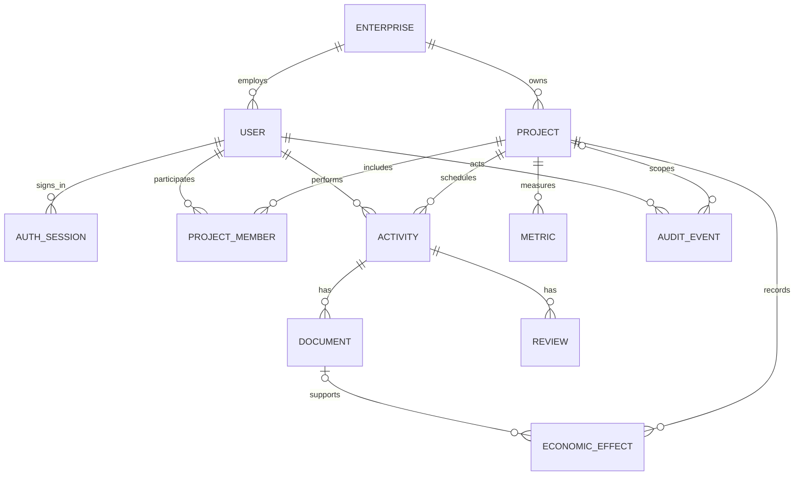

# Backend foundation

FastAPI + Pydantic v2 + SQLAlchemy 2 + Alembic. The folder layout follows the local
`AIMarket` project: `app/core`, `app/models`, `app/schemas`, `app/api/v1/routers`,
`app/services`, `app/repositories` and `migrations`. The internal `v1` package
does not change the external draft API prefix `/api`.

The current branch contains a **database and DTO draft**, not business endpoints.
`GET /health` is the only implemented route. Authorization, permissions, transitions,
uploads, exports and integration tests must be implemented before a functional demo.

## Layout

```text
backend/
  app/
    api/v1/       # route composition; resource routers follow the approved contract
    common/       # shared enums
    core/         # settings and DB sessions
    models/       # SQLAlchemy tables and relationships
    repositories/ # data access modules when routes are implemented
    schemas/      # Pydantic request and response DTOs
    services/     # workflows, permissions and transactions when implemented
    main.py       # FastAPI entry point
  migrations/     # Alembic initial schema
```

## Database design



All business IDs are UUIDs. All foreign keys restrict deletion. The ORM stores
timestamps in UTC and dates as calendar dates. `version` supports optimistic
concurrency. `AuthSession` stores hashed session and CSRF tokens for revocation;
neither raw token belongs in the database. `Document.storage_key` is a private
storage reference and never appears in a DTO. Reviews and audit events are
append-only by application policy.

The database checks enum values, local date ranges, required numeric values,
unique `(activity_id, kind, revision)` documents, unique review stage per cycle,
and case-insensitive login uniqueness. Cross-table rules belong to transactions
in the service layer: enterprise membership, active assignees, reviewer roles,
activity dates within project dates, effect documents from the same project,
allowed status transitions, and `expectedVersion` updates.

`progressPercent` and `isOverdue` are response calculations, not stored columns.
`isOverdue` uses the calendar date in `Asia/Yekaterinburg` according to the draft.
Monetary values use `numeric(18,2)` and KPI values use `numeric(18,4)` in the DB;
the API returns decimal strings.

## DTOs and API contract

The Pydantic classes in `app/schemas` mirror the draft API contract on the
separate `docs/backend-contract-v01` branch: camelCase
JSON aliases, UUID/date/timestamp types, enum values, request length limits,
decimal strings and required `expectedVersion` on updates. PATCH models use
`model_fields_set` to distinguish an omitted field from explicit `null`.
`Page[T]` and `Problem` define the shared list and error response shapes.

Route signatures and response models will be added with their authorization and
workflow rules. Publishing empty success handlers would misrepresent the API.

## Local setup

Use Python 3.12+ and a PostgreSQL database. From `backend/`:

```powershell
python -m venv .venv
.\.venv\Scripts\Activate.ps1
python -m pip install -e ".[dev]"
Copy-Item .env.example .env
# Set DATABASE_URL in .env to your local PostgreSQL instance.
python -m alembic upgrade head
uvicorn app.main:app --reload
```

Do not commit `.env`, database dumps, uploaded files or real customer data.

## Decisions still open

- Whether a project can complete after internal approval or only after external acceptance.
- Required activity/document templates and date norms from the RCK methodology.
- Whether coordinator or project manager owns creation and manual federal status entry.
- How anonymous pre-login CSRF sessions and production cookie settings will be finalized.
- File scanning, retention and deployment topology.

The model and DTOs can change when the team and customer settle these points.
